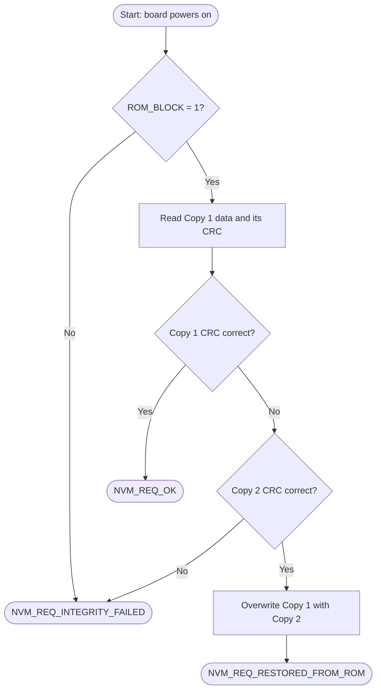

# EEPROM Redundant Read with CRC Fallback

Embedded C | S32 Design Studio | I2C EEPROM | CRC | UART

A small embedded project that protects a value stored in EEPROM against corruption. The value is stored twice (a **main copy** and a **backup copy**), each with a **CRC** check code. At start-up the program checks the main copy and, if it is damaged, repairs it from the backup. All steps are printed over UART so they can be watched in PuTTY.

---
## Table of contents

| No. | Section | What it covers |
|---|---|---|
| 1 | [What this project does](#1-what-this-project-does) | Purpose and basic idea |
| 2 | [Requirements and scope](#2-requirements-and-scope) | Requirements R1 to R5 |
| 3 | [How it works](#3-how-it-works) | Flowchart and step-by-step logic |
| 4 | [EEPROM memory map](#4-eeprom-memory-map) | Addresses and test data |
| 5 | [Status codes](#5-status-codes) | OK, restored, failed |
| 6 | [Hardware and software used](#6-hardware-and-software-used) | Board, EEPROM, tools |
| 7 | [Project structure](#7-project-structure) | Folders and files |
| 8 | [Configuration](#8-configuration) | Macros, components, PuTTY settings |
| 9 | [How to build and run](#9-how-to-build-and-run) | Build, flash and test steps |
| 10 | [Test cases](#10-test-cases) | TC1 to TC5 |
| 11 | [Sample UART output](#11-sample-uart-output) | Expected PuTTY output |
| 12 | [Code overview](#12-code-overview) | Functions and messages |
| 13 | [Limitations and future work](#13-limitations-and-future-work) | Known gaps and improvements |
| 14 | [Author](#15-author) | Name, institution, contact |
---

## 1. What this project does

Data stored in memory can become corrupted (power loss during a write, noise, wear). A common protection is to keep **two copies** of the data and a **CRC** (a number calculated from the data) for each copy.

In this project:

- **Copy 1** is the main copy the application would normally use.
- **Copy 2** is a backup (mirror) copy.
- A **CRC** is stored next to each copy. If the data is changed or damaged, the recalculated CRC no longer matches the stored one.
- A flag called **`ROM_BLOCK`** must be `1` to allow the fallback.

The program verifies Copy 1. If it is damaged, it checks Copy 2 and, if Copy 2 is good, overwrites Copy 1 with it.

## 2. Requirements and scope

| Rx | Requirement |
|---|---|
| R1 | When `ROM_BLOCK = 1`, check the CRC of Copy 1. |
| R2 | If the Copy 1 CRC fails, call `NvM_ReadMirrorCopy()` to fetch Copy 2 and report `NVM_REQ_RESTORED_FROM_ROM`. |
| R3 | If `ROM_BLOCK = 0`, report `NVM_REQ_INTEGRITY_FAILED`. |
| R4 | Initial values of `ROM_BLOCK`, Copy 1 and Copy 2 are written by a provisioning function, then verified over UART. |


## 3. How it works



Step by step:

1. Initialise clock, pins, UART, I2C and the CRC module.
2. If `ENABLE_EEPROM_PROVISIONING` is `1U`, write the test data to EEPROM.
3. Read `ROM_BLOCK`. It must be exactly `1`; `0` or any other value ends with an error.
4. Read Copy 1 data and its stored CRC, then recalculate the CRC and compare.
5. If the CRCs match, report `NVM_REQ_OK`.
6. If they differ, read Copy 2 (`NvM_ReadMirrorCopy()`) and run the same check.
7. If Copy 2 is bad, report `NVM_REQ_INTEGRITY_FAILED`.
8. If Copy 2 is good, write its data and CRC over Copy 1 and report `NVM_REQ_RESTORED_FROM_ROM`.

> A draw.io version of the flowchart is in `docs/` so it can be edited.

## 4. EEPROM memory map

| Item | Address | Size | Description |
|---|---|---|---|
| Copy 1 data | `0x0000` | 4 bytes | Main stored value |
| Copy 1 CRC | `0x0004` | 4 bytes | Check code for Copy 1 |
| Copy 2 data | `0x0010` | 4 bytes | Backup (mirror) value |
| Copy 2 CRC | `0x0014` | 4 bytes | Check code for Copy 2 |
| `ROM_BLOCK` | `0x0020` | 1 byte | Flag: `1` = fallback allowed |

### Test data written by provisioning

| Item | Value | Note |
|---|---|---|
| `ROM_BLOCK` | `1` | Fallback enabled |
| Copy 1 data | `67892` | |
| Copy 1 CRC | CRC of `12345` | **Deliberately wrong** for `67892`, to simulate corruption |
| Copy 2 data | `12345` | |
| Copy 2 CRC | CRC of `12345` | Correct |

## 5. Status codes

| Status | Value | Meaning |
|---|---|---|
| `NVM_REQ_OK` | 0 | Copy 1 is valid. Nothing to repair. |
| `NVM_REQ_RESTORED_FROM_ROM` | 1 | Copy 1 was invalid, Copy 2 was valid, Copy 1 was repaired. |
| `NVM_REQ_INTEGRITY_FAILED` | 2 | Flag off or invalid, an I2C read/write error, or both copies invalid. |

## 6. Hardware and software used

### Hardware

| Item | Details |
|---|---|
| Microcontroller board | `NXP S32K144 Development Board` |
| EEPROM | I2C EEPROM at 7-bit address `0x50`, 256-byte address space |
| Connections | LPI2C0 SDA/SCL to the EEPROM (with pull-ups), LPUART_1 TX/RX to the PC through USB-serial |
| PC | Windows with a free COM port |

### Software

| Tool | Version / note |
|---|---|
| S32 Design Studio | `3.5.0.0` |
| PuTTY | `0.85` |

## 7. Project structure

```
eeprom-redundant-read-crc-fallback/
├── src/
│   ├── main.c            Application: provisioning, CRC check, fallback logic
│   └── eeprom.c          I2C EEPROM read/write driver
├── include/
│   └── eeprom.h          EEPROM driver declarations
├── docs/
│   ├── flowchart.png     Flowchart image
│   ├── eeprom_flowchart.drawio   Editable flowchart
│   └── documentation.pdf Full project documentation
├── images/               PuTTY screenshots and board photos
├── README.md
├── LICENSE
└── .gitignore
```


## 8. Configuration

### 8.1 Compile-time switches (`main.c`)

| Macro | Default | Purpose |
|---|---|---|
| `ENABLE_EEPROM_PROVISIONING` | `0U` | `1U` writes the test data to EEPROM at start-up. `0U` uses the data already stored. |
| `INITIAL_ROM_BLOCK` | `1U` | Value written to `ROM_BLOCK` |
| `INITIAL_COPY1_DATA` | `67892U` | Copy 1 data |
| `INITIAL_COPY2_DATA` | `12345U` | Copy 2 data, also used for the deliberately wrong Copy 1 CRC |

### 8.2 S32 Design Studio components

| Peripheral | Name used in code | Setting |
|---|---|---|
| Clock | `clockMan1_InitConfig0` | Enables the LPUART, LPI2C and CRC modules |
| Pins | `g_pin_mux_InitConfigArr0` | UART TX/RX and I2C SDA/SCL routed to the board |
| UART | `INST_LPUART_1`, `lpuart_0_InitConfig0` | Baud rate `115200`, 8 data bits, no parity, 1 stop bit |
| I2C | `INST_LPI2C0`, `lpi2c0_MasterConfig0` | Master mode, speed `100000` |
| CRC | `INST_CRC_1`, `crc_1_Cfg0` | Polynomial and width `<set yours>` |
| OSIF | `OSIF_TimeDelay()` | Used for the 5 ms EEPROM write delay |

### 8.3 EEPROM driver rules (`eeprom.c`)

| Item | Value |
|---|---|
| I2C slave address | `0x50` |
| Timeout | 100 ms |
| Address space | 256 bytes |
| Max bytes per write | 16 |
| Page rule | A write must not cross a 16-byte page boundary |
| Write cycle delay | 5 ms |

### 8.4 PuTTY settings


## 9. How to build and run

1. Clone the repository and open it in S32 Design Studio (File > Import > Existing Projects into Workspace).
2. Make sure the S32 SDK is installed and the components in section 8.2 are configured.
3. In `main.c`, set `ENABLE_EEPROM_PROVISIONING` to `1U`.
4. Build the project and flash it to the board.
5. Open PuTTY with the settings in section 8.4 and reset the board.
6. Check the first output (section 11.1). Provisioning runs first, then the test runs in the same boot.
7. Set `ENABLE_EEPROM_PROVISIONING` back to `0U`, rebuild and flash.
8. Reset the board and check the second output (section 11.2).

> **Note:** The repair is saved permanently in EEPROM. To see the fallback again, set the switch to `1U` and re-flash.

## 10. Test cases

| ID | Setup | Expected behaviour | Expected status |
|---|---|---|---|
| TC1 | Provisioning on, default values | Copy 1 CRC fails, Copy 2 CRC passes, Copy 1 is repaired | `NVM_REQ_RESTORED_FROM_ROM` |
| TC2 | Provisioning off, run again after TC1 | Copy 1 now passes its CRC check | `NVM_REQ_OK` |
| TC3 | Provisioning on, `INITIAL_ROM_BLOCK = 0U` | `ROM_BLOCK is 0`, no CRC check | `NVM_REQ_INTEGRITY_FAILED` |
| TC4 | Provisioning on, `INITIAL_ROM_BLOCK = 2U` | `ROM_BLOCK is invalid` | `NVM_REQ_INTEGRITY_FAILED` |
| TC5 (optional) | Provisioning changed so the Copy 2 CRC is also wrong | Copy 1 fails, then `Copy 2 CRC FAILED` | `NVM_REQ_INTEGRITY_FAILED` |

## 11. Sample UART output


### 11.1 First run (TC1)


### 11.2 Second run (TC2)


### 11.3 ROM_BLOCK = 0 (TC3)


### 11.4 Screenshots

| Test | Screenshot |
|---|---|
| TC1 first run | `images/tc1_restored.png` |
| TC2 second run | `images/tc2_ok.png` |
| TC3 ROM_BLOCK = 0 | `images/tc3_failed.png` |

## 12. Code overview

| File | Function | Purpose |
|---|---|---|
| `main.c` | `main()` | Initialises peripherals, optionally provisions EEPROM, runs the test and prints the final status |
| `main.c` | `UART_Print()` | Sends a string over UART and waits until it is sent |
| `main.c` | `CalculateCRC()` | Re-initialises the CRC module and returns the CRC of a 32-bit value |
| `main.c` | `EEPROM_Read32()` | Reads a 32-bit value from EEPROM |
| `main.c` | `ProvisionEEPROMData()` | Writes `ROM_BLOCK`, Copy 1 (with wrong CRC) and Copy 2 (with correct CRC) |
| `main.c` | `NvM_ReadMirrorCopy()` | Reads and validates Copy 2 |
| `main.c` | `RedundantReadTest()` | Flag check, Copy 1 check, fallback and restore |
| `eeprom.c` | `EEPROM_ReadBytes()` | I2C read of 1 to 256 bytes |
| `eeprom.c` | `EEPROM_WriteBytes()` | Page-safe I2C write, then a 5 ms wait |

### UART message reference

| Message | Meaning |
|---|---|
| `ROM_BLOCK = n` | Flag value read from EEPROM |
| `Copy 1 CRC OK` / `Copy 1 CRC FAILED` | Result of the Copy 1 check |
| `Reading mirror copy...` | Fallback to Copy 2 started |
| `Copy 2 CRC OK` / `Copy 2 CRC FAILED` | Result of the Copy 2 check |
| `Copy 1 restored from Copy 2` | Repair finished |
| `ERROR: ... failed` | An I2C read or write returned an error |

## 13. Limitations and future work

| Limitation | Possible improvement |
|---|---|
| Only 2 fixed blocks | Make it a configuration-driven table of many blocks |
| Copy 1 is not re-checked after the repair | Add a second CRC check after the restore |
| Only Copy 1 is repaired | Also repair Copy 2 when Copy 2 is the damaged one |
| `ROM_BLOCK` is a single unprotected byte | Protect the flag itself with a CRC or store it twice |
| Program stops in an endless loop after the test | Run the check periodically or on request |


## 14. Author

| | |
|---|---|
| Name        | `THARUN DANIEL Y` |
| Institution | `SAVEETHA ENGINEERING COLLEGE` |
